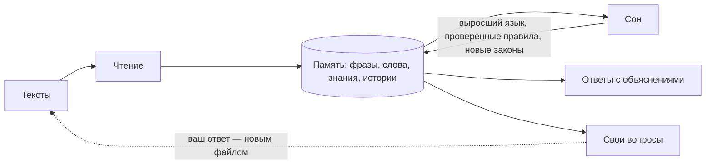
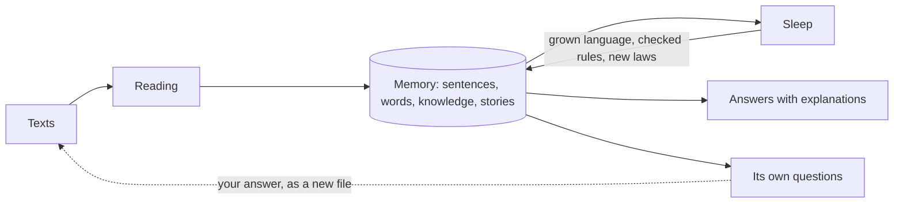

# light · «Росток»

**Система, которая учится как ребёнок: по нескольким страницам текста, без обучения нейросети и без больших языковых моделей. Она рассуждает и объясняет ход мыслей, сама задаёт вопросы и замечает противоречия.**

**A system that learns like a child: from a few pages of text, without neural-network training and without large language models. It reasons and explains how it got there, asks its own questions and notices contradictions.**

[Русский](#русский) · [English](#english)

> Исследовательский прототип. Понимает только русский язык. Работает без интернета, на обычном компьютере, за секунды.
>
> A research prototype. Understands Russian only. Runs offline on an ordinary computer, in seconds.

---

## Русский

### Что это

`light` — экспериментальная система искусственного разума. Её главная часть — **«Росток»**: система, которая рождается пустой (ни слов, ни знаний, ни правил) и вырастает только из тех текстов, которые вы ей даёте. Вы кладёте файлы в папку, а она их читает, «спит» (перечитывает всё и проверяет себя), отвечает на вопросы с объяснениями и задаёт свои.

Ответ после чтения стартового набора текстов, слово в слово:

> **Вы:** Зачем лиса хвалила ворону?
>
> **Росток:** Чтобы получить сыр: лиса хочет сыр, и это ведёт к цели: лиса хвалит ворону → ворона радуется → ворона поёт → сыр падает (ведь ворона держит сыр) → лиса берёт сыр (ведь лиса хочет сыр). (из истории в «13_басня_литературно.txt»)

Такого ответа нет ни в одном тексте. Цепочку «похвала → радость → пение → сыр падает» она вывела из правил, которые сама вырастила на простых сказках («Мама хвалит сына. Сын радуется.»).

### Зачем это

Большие языковые модели учатся на триллионах слов, и их знания размазаны по миллиардам чисел. Здесь проверяется другой путь:

- **учиться по малому** — по паре страниц, как ребёнок;
- **расти по материалу** — память занимает столько, сколько выучено, а не заранее заданную таблицу чисел (после всего стартового набора — около 150 КБ);
- **объяснять каждый вывод** — цепочкой рассуждений и источником («так написано в …»);
- **сомневаться** — если тексты противоречат друг другу, знание не затирается: появляется вопрос «как правильно?»;
- **спрашивать** — о том, что непонятно и что важнее всего узнать;
- **проверять себя** — во сне перечитывать всю память с выросшим языком, проверять свои правила, отказываться от совпадений и возвращать то, от чего отказалась зря.

Это площадка для исследования: как далеко можно зайти без больших моделей и где проходят границы.

### Что умеет — и чего не умеет

Все цифры — из автоматических тестов (`python3 -m unittest discover tests`).

| Проверка | Результат |
|---|---|
| Экзамен по фактам, которых нет ни в одном тексте («Дышит ли пингвин?») | **12 из 12** — выводит через роды: пингвин → птица → животное → дышит |
| Законы из записей измерений | **5 законов**: маятник (масса не влияет), падение, закон Ома, площадь круга, Пифагор |
| Сложные «энциклопедические» фразы | понято 14 из 15 предложений, 42 факта без мусора |
| Литературный пересказ басни | сначала честно не знает «зачем» и спрашивает о незнакомых словах; после ответов понимает |
| Оригинал басни Крылова, без пересказов | с уроками о том, как звучат похвала и просьба, и с ответами на её вопросы о словах басни (мотива в уроках нет) отвечает «зачем», «почему», «что было бы, если бы…», «обманула ли» |
| **Новые рассказы, слепая проверка** | **верно около половины событий (19 из 38); «зачем» — 0 из 3** |

Честно: на текстах, по которым отлаживался разбор, верно 83–100%, на новых — около 50%. Подробности: [docs/RESULTS.md](docs/RESULTS.md) и [docs/SCHOOL.md](docs/SCHOOL.md).

### Быстрый старт

Нужны Python 3 (проверено на 3.13) и numpy.

```bash
git clone https://github.com/no-ro-ko/light.git
```

```bash
cd light
```

```bash
pip install -r requirements.txt
```

Все команды запускайте из папки проекта (`light`): как пакет он не устанавливается.

1. Положить стартовый набор текстов во «входящие»:

```bash
python3 -m light.rost.school начать
```

2. Прочитать, поспать и записать ответы (несколько секунд):

```bash
python3 -m light.rost.school учиться
```

3. Задать вопрос:

```bash
python3 -m light.rost.school спросить "Зачем лиса хвалила ворону?"
```

4. Поговорить. Вопрос пишется с «?», всё остальное — новые знания; пустая строка — её вопросы к вам, `выход` — конец:

```bash
python3 -m light.rost.school беседа
```

Ответы, её вопросы и отчёт появятся в папке `данные/ответы/`.

| Команда | Что делает |
|---|---|
| `начать` | кладёт стартовый набор текстов (`curriculum/`) во «входящие» |
| `учиться` | читает новые файлы, спит, записывает ответы, вопросы, отчёт и журнал |
| `следить` | то же само, как только во «входящих» появляются файлы (`--раз-в 5` — раз в 5 секунд) |
| `спросить "…"` | один вопрос |
| `беседа` | разговор |
| `отчёт` | как она выросла |
| `--папка ПУТЬ` | где хранить данные (по умолчанию `данные/`) |

### Как учить её своими текстами

Положите `.txt` (или `.md`) в `данные/входящие/` и запустите `учиться`. Или один раз запустите `следить`: тогда она будет учиться сама, как только появятся файлы. Прочитанное переносится в `данные/изучено/`, и один и тот же текст дважды не читается. Кодировка — UTF-8, Windows-1251 или KOI8-R.

| Папка / файл | Что там |
|---|---|
| `данные/входящие/` | сюда кладутся ваши тексты; строки с «?» — вопросы к ней |
| `данные/изучено/` | прочитанное |
| `данные/ответы/ответы.txt` | ответы на вопросы из ваших файлов, с объяснениями |
| `данные/ответы/мои_вопросы.txt` | что ей непонятно: незнакомые слова и герои, противоречия, просьбы о новых измерениях |
| `данные/ответы/отчёт.txt` | как она выросла: формы слов, понятия, факты, правила, законы; сколько понято в каждом файле |
| `данные/ответы/журнал.txt` | что она изменила в себе во сне |
| `данные/росток.pkl` | её память между запусками; удалите папку `данные/`, чтобы начать с нуля |

**Как писать, чтобы она поняла.** Простыми фразами, по-русски, «лесенкой»: сначала простое, потом сложнее. Абзац, отделённый пустой строкой, — одна история.

| Чему учить | Как написать |
|---|---|
| род и свойства | «Кит — это млекопитающее.» «Птицы летают.» «Пингвин не летает.» |
| определение | «Лесть — это похвала ради выгоды.» |
| слово, которое значит то же | «Запела — значит поёт.» «Лисица — то же, что лиса.» |
| то же другими словами, с ролями | «Мяч пленил кошку — значит, кошка хочет мяч.» |
| причины | «Если идёт дождь, то земля мокрая.» «Лёд тает, потому что его нагревают.» |
| измерения (закон найдёт сама) | несколько строк вида «Маятник: длина 0.5 м, масса 1 кг, период 1.424 с.» |
| ощущения | «Зелёный — это свет с длиной волны от 500 до 565 нанометров.» «Листья зелёные.» |
| простые истории (из них растут правила) | «Кот толкает вазу. Ваза падает.» |
| рассказы | обычный абзац в прошедшем времени |
| как звучит речь | «Мама хвалила дочку: «Какая ты умница!»» |
| ответ на её вопрос | новый файл с ответом: «Прямоугольник это фигура.» |

### Какие вопросы она понимает

«Дышит ли кит?» · «Является ли квадрат фигурой?» · «Кто умеет летать?» · «Что ты знаешь о лисе?» · «Чем отличаются кит и акула?» · «Где живёт пингвин?» · «Все ли птицы летают?» · «Что значит зелёный?» · «Зачем лиса хвалила ворону?» · «Почему сыр упал?» · «Что было бы, если бы лиса не хвалила ворону?» · «Обманула ли лиса ворону?» · «Какая мораль?» · «Перескажи басню» · «Что будет, если вазу толкнуть?» · «Чему равен период, если длина 4?» · «Какой должна быть длина, чтобы период был 3?» · «В чём ты сомневаешься?» · «В чём ты ошибалась?» · «Что ты хочешь узнать?» · «Как ты выросла?»

Настоящие ответы, как есть:

```text
? Кто умеет летать?
  Летает: летучая мышь, птица, пчела; а по выводу ещё: ворона, синица, сова.

? Обманула ли лиса ворону?
  Похоже, да: лиса хвалит ворону не ради неё самой, а чтобы получить сыр, который был у неё.
  Лесть — это похвала ради выгоды. (из истории в «13_басня_литературно.txt»)

? Что значит зелёный?
  «зелёный» — это свет с длиной волны 500–565 нм; например: листья, трава.

? Чему равен период, если длина 4?
  Период ≈ 4.02. По закону, который я нашла в записях измерений: период = 2.008 · длина^½; не влияет: масса.
```

Пингвина среди летающих нет: она знает исключение. О вороне, синице и сове прямо не сказано, что они летают, — это вывод: они птицы.

### Как она устроена



Код — в `light/rost/`:

- **`organism.py`** — сам «Росток»: чтение, сон, ответы, свои вопросы. Каждая фраза — определение, измерение, причина, факт, сложная фраза или часть рассказа.
- **`language.py`** — язык, выросший из текстов: формы слов и окончания («животное / животные / животным» — одно слово), чередования («держала» ~ «держит», «орлы» ~ «орёл»), новые обороты («X является Y») по уже известным фактам.
- **`knowledge.py`** — понятия, роды и свойства с источником каждого; наследование и исключения («пингвин не летает, хотя птицы летают»), осторожное «наверное», честное «не знаю», сомнения.
- **`syntax.py`** — сложная фраза → простые («Киты — крупные морские млекопитающие» → кит — млекопитающее; кит крупный; кит морской).
- **`causes.py`** — «если …, то …», «потому что», «поэтому».
- **`narrative.py`** — рассказы: кто — что делает — кого; «она», «его», «птица» — это ворона; род узнаётся из опыта; похвала и просьба в прямой речи.
- **`rules.py`** — правила историй («X хвалит Y → Y радуется»): вырастают из повторов, проверяются во сне, уточняются или отвергаются.
- **`measures.py`** — законы: поиск постоянного сочетания величин в записях измерений.
- **`school.py`** — папки, команды, память между запусками.

Врождённого немного, и оно перечислено честно: «не», «это», «—», «ли», 57 служебных слов (предлоги, союзы, местоимения), притяжательные («свой», «мой»…), «хочет» как желание, «X — значит Y». Всё остальное — из прочитанного.

### Новое: песочница «Мир» — учёба на собственном опыте

Всё выше учится по текстам, то есть по чужим описаниям мира. В `light/mir/` — первый шаг по другому пути: маленький мир из клеток (песок, вода, камень, дерево, огонь, лёд и «я», который ходит, копает, поджигает, толкает), где существо учится предсказывать последствия **собственным опытом**, а не по словам.

Главное здесь — **прибор**: проверки «удивлением», как у младенцев. Модели показывают пары «возможное / невозможное» событие в небывалых окружениях, и по тому, чему она удивляется сильнее, видно, что она выучила. Прибор сам проверен эталонами («знает все законы» — 100%, «ничего не меняется» — 28%), а запечатанный набор открывался только после того, как условия успеха были записаны и закоммичены (журнал обращений — `mir_runs/sealed_log.jsonl`).

Что получилось (запечатанный набор, три независимых потока опыта, подробнее в [docs/MIR.md](docs/MIR.md)):

- **Растущая кора** из сегментов-условий (без обратного распространения) выучила законы мира почти полностью: 98% на 10 000 тактах опыта. Выученное читается словами: «лёд тает, если рядом огонь», «сухое дерево загорается, если рядом огонь».
- **Обычная сеть** с теми же входами: около 90% на 10 000 тактах; редкие законы (таяние льда, мокрое дерево) знает плохо даже на 30 000. Для одной и той же точности коре нужно примерно втрое меньше опыта. Но по заранее записанному порогу «90%» их цена опыта совпала, поэтому гипотеза «втрое меньше» формально **не** подтвердилась.
- **Сон** (обобщение правил) пользы не дал. **Любопытство** вида «иди туда, где не уверена» не помогло; «тянусь к предметам, которыми мало занималась» дало небольшой выигрыш (в среднем +3…+5 п.п. на малых и средних бюджетах).
- **Граница:** когда закон мира меняется, кора переучивается очень медленно.
- **Дневник поверх коры** (быстрая кора недавнего опыта и «арбитр» между ней и медленной корой): при смене закона учится быстрее одной коры (через 3 000 тактов направление осыпания и течения верно в 73% пар против 43%), в спокойном мире ничего не портит и лучше простого забывания, которое быстро, но роняет уверенность. Заранее записанный порог скорости при этом **не выполнен** (53% вместо 55% на 1 000 тактах) — подробности в [docs/MIR.md](docs/MIR.md), разд. 13–14.

```bash
python3 -m unittest tests.test_mir                # законы мира, прибор, обучение (около 10 секунд)
python3 -m light.mir.report curves --key sealed   # кривые «опыт → итог» из сохранённых запусков
```

### Другие части репозитория

«Росток» — последняя и главная часть. До него построены и описаны отдельные модули:

| Часть | Что делает | Описание |
|---|---|---|
| `light/brain.py`, `workspace.py`, `nodes.py` | «мозг»: сцена внимания и отделы; к отделам можно подключить любую языковую модель, но это не обязательно | [ARCHITECTURE.md](docs/ARCHITECTURE.md) |
| `light/self_model.py` | я-модель: отчёты о себе, «почему ты так думаешь?», «в чём ты ошибалась?» | [RESULTS.md §5](docs/RESULTS.md) |
| `light/cortex/` | кора: колонки, нейромодуляторы, сон | [CORTEX.md](docs/CORTEX.md) |
| `light/mind/` | «детский» разум в маленьком мире: категории без меток, слова, рассуждение, любопытство, цвет | [RESULTS.md §1, §3](docs/RESULTS.md) |
| `light/lab/` | учёный: сам ставит опыты и находит законы | [RESULTS.md §2](docs/RESULTS.md) |
| `light/sema/` | СЕМА — нейросеть смыслов | [SEMA.md](docs/SEMA.md) |
| `light/rost/fabric.py` | «Росток» на образах: рождается пустым, растёт, во сне перестраивает себя | [ROSTOK.md](docs/ROSTOK.md) |
| `light/mir/` | песочница из клеток, проверки «удивлением», растущая кора и обычная сеть для сравнения | [MIR.md](docs/MIR.md) |

Разговор с «детским» разумом (своя память — файл `light_state.pkl`):

```bash
python3 -m light.cli
```

В нём есть команды `/читать ФАЙЛ`, `/лаборатория`, `/задачи`, `/прожить N`, `/сохранить`, `/выход`.

Демонстрации:

```bash
python3 examples/rostok_demo.py
```

```bash
python3 examples/cortex_demo.py
```

```bash
python3 examples/demo.py
```

`demo.py` заодно показывает, как подключить к отделам «мозга» языковую модель через OpenAI-совместимый сервер (например, Ollama). «Ростку» это не нужно.

### Проверки

```bash
python3 -m unittest discover tests
```

110 тестов, около двух с половиной минут (21 из них — про песочницу «Мир»). Слепая проверка на новых рассказах — в `tests/test_unseen.py`. Правило честной проверки: рассказы и эталон пишутся до первого запуска и потом не подгоняются. Если по рассказу исправляли разбор, он уже не слепой, и для новой проверки нужны новые рассказы.

### Честные границы

- Понимает только русский язык и знает только прочитанное: других знаний о мире у неё нет.
- Язык: простые утверждения, «энциклопедическая» речь и простое повествование. На новых рассказах верно около половины событий.
- Мотивы находит только в пределах выросших правил («похвала → радость → пение → падение»). Что «лиса хвалит петуха, чтобы его съесть», — пока нет.
- Незнакомые слова связывает со знакомыми, только когда объясните; зато сама о них спрашивает.
- Ответы бывают корявыми по грамматике («кит дышат»).
- Есть ли у системы переживание, не доказано и не может быть доказано этими тестами (см. [RESULTS.md §5](docs/RESULTS.md)).

### Документация

| Документ | О чём |
|---|---|
| [docs/RESULTS.md](docs/RESULTS.md) | что умеет вся система, что измерено, что нет |
| [docs/SCHOOL.md](docs/SCHOOL.md) | школа «Ростка»: чтение, рассказы, Крылов, слепая проверка |
| [docs/ROSTOK.md](docs/ROSTOK.md) | растущая сеть на образах |
| [docs/ARCHITECTURE.md](docs/ARCHITECTURE.md) | «мозг»: сцена внимания и отделы |
| [docs/CORTEX.md](docs/CORTEX.md) | корковая сеть |
| [docs/SEMA.md](docs/SEMA.md) | нейросеть смыслов |
| [docs/MIR.md](docs/MIR.md) | песочница «Мир»: проверки «удивлением», кора против обычной сети, результаты |

### Лицензия

[MIT](LICENSE): код и тексты можно свободно использовать, менять и распространять, в том числе в коммерческих проектах, если сохранить уведомление об авторстве и текст лицензии. Без каких-либо гарантий.

---

## English

### What it is

`light` is an experimental artificial-mind system. Its core is **Rostok** (Russian for "sprout"). Rostok is born empty (no words, no knowledge, no rules) and grows only from the texts you give it. You drop files into a folder; it reads them, "sleeps" (re-reads everything and checks itself), answers questions with explanations, and asks questions of its own.

**It reads and answers in Russian only.** Translations below are given in italics.

Its answer after reading the starter set of texts, word for word:

> **You:** Зачем лиса хвалила ворону? *(Why did the fox praise the crow?)*
>
> **Rostok:** Чтобы получить сыр: лиса хочет сыр, и это ведёт к цели: лиса хвалит ворону → ворона радуется → ворона поёт → сыр падает (ведь ворона держит сыр) → лиса берёт сыр (ведь лиса хочет сыр). (из истории в «13_басня_литературно.txt»)
>
> *(To get the cheese: the fox wants the cheese, and this leads to the goal: the fox praises the crow → the crow rejoices → the crow sings → the cheese falls (because the crow is holding it) → the fox takes the cheese (because the fox wants it). — from the story in "13_басня_литературно.txt")*

None of the texts contains this answer. Rostok derived the chain "praise → joy → singing → the cheese falls" from rules it grew by itself on simple tales ("Мама хвалит сына. Сын радуется." — *"Mom praises her son. The son rejoices."*).

### Why

Large language models learn from trillions of words, and their knowledge is spread across billions of numbers. This project explores a different path:

- **learning from very little** — a couple of pages, like a child;
- **growing with the material** — memory takes as much space as has been learned, not a table of numbers fixed in advance (about 150 KB after the whole starter set);
- **explaining every conclusion** — with the chain of reasoning and the source ("it is written in …");
- **doubting** — when texts contradict each other, nothing is overwritten; instead the question "which is right?" appears;
- **asking** — about what is unclear and what matters most to learn;
- **checking itself** — in sleep it re-reads its whole memory with the language it has grown, checks its rules, drops coincidences, and brings back rules it dropped by mistake.

It is a research playground: how far can one go without large models, and where are the limits?

### What it can and cannot do

All numbers come from the automated tests (`python3 -m unittest discover tests`).

| Check | Result |
|---|---|
| Exam on facts that appear in no text ("Does a penguin breathe?") | **12 of 12** — inferred through kinds: penguin → bird → animal → breathes |
| Laws found in records of measurements | **5 laws**: pendulum (mass does not matter), free fall, Ohm's law, area of a circle, Pythagoras |
| Complex "encyclopedic" sentences | 14 of 15 sentences understood, 42 facts, no garbage |
| A literary retelling of the fable | at first it honestly does not know "why" and asks about unknown words; after the answers it understands |
| The original Krylov fable, with no retellings | given lessons on how praise and requests sound and answers to its own questions about the fable's words (the motive is in none of the lessons), it answers "why", "what made it happen", "what if not", "did the fox deceive" |
| **New stories, blind test** | **about half of the events right (19 of 38); "why" questions — 0 of 3** |

Honestly: on the texts the parser was debugged on it gets 83–100%, on new ones about 50%. Details (in Russian): [docs/RESULTS.md](docs/RESULTS.md), [docs/SCHOOL.md](docs/SCHOOL.md).

### Quick start

You need Python 3 (tested on 3.13) and numpy.

```bash
git clone https://github.com/no-ro-ko/light.git
```

```bash
cd light
```

```bash
pip install -r requirements.txt
```

Run all commands from the project folder (`light`): the project is not installed as a package. The commands themselves are Russian words.

1. Put the starter set of texts into the inbox (`начать` = *start*):

```bash
python3 -m light.rost.school начать
```

2. Read, sleep and write the answers (`учиться` = *learn*; takes a few seconds):

```bash
python3 -m light.rost.school учиться
```

3. Ask a question (`спросить` = *ask*):

```bash
python3 -m light.rost.school спросить "Зачем лиса хвалила ворону?"
```

4. Chat (`беседа` = *conversation*). A line ending with "?" is a question, anything else is new knowledge; an empty line shows its questions to you; `выход` (*exit*) ends:

```bash
python3 -m light.rost.school беседа
```

Answers, its questions and the report appear in `данные/ответы/` (*data/answers*).

| Command | What it does |
|---|---|
| `начать` (*start*) | copies the starter texts (`curriculum/`) into the inbox |
| `учиться` (*learn*) | reads new files, sleeps, writes answers, questions, report and journal |
| `следить` (*watch*) | the same, whenever files appear in the inbox (`--раз-в 5` = every 5 seconds) |
| `спросить "…"` (*ask*) | one question |
| `беседа` (*conversation*) | a chat |
| `отчёт` (*report*) | how it has grown |
| `--папка PATH` (*folder*) | where to keep the data (default `данные/`) |

### Teaching it with your own texts

Put `.txt` (or `.md`) files into `данные/входящие/` (*data/inbox*) and run `учиться`. Or run `следить` once, and it will learn by itself whenever files appear. Read files move to `данные/изучено/` (*data/studied*); the same text is never read twice. Encodings: UTF-8, Windows-1251 or KOI8-R.

| Folder / file | Contents |
|---|---|
| `данные/входящие/` (*inbox*) | your texts go here; lines ending with "?" are questions to it |
| `данные/изучено/` (*studied*) | what it has read |
| `данные/ответы/ответы.txt` (*answers*) | answers to the questions in your files, with explanations |
| `данные/ответы/мои_вопросы.txt` (*my questions*) | what it does not understand: unknown words and heroes, contradictions, requests for new measurements |
| `данные/ответы/отчёт.txt` (*report*) | how it has grown: word forms, concepts, facts, rules, laws; how much it understood in each file |
| `данные/ответы/журнал.txt` (*journal*) | what it changed in itself during sleep |
| `данные/росток.pkl` | its memory between runs; delete the `данные/` folder to start from scratch |

**How to write so that it understands.** Simple sentences, in Russian, step by step: simple texts first, then harder ones. A paragraph (separated by an empty line) is one story.

| What to teach | How to write it |
|---|---|
| kinds and properties | «Кит — это млекопитающее.» «Птицы летают.» «Пингвин не летает.» *(A whale is a mammal. Birds fly. A penguin does not fly.)* |
| a definition | «Лесть — это похвала ради выгоды.» *(Flattery is praise for gain.)* |
| a word that means the same | «Запела — значит поёт.» «Лисица — то же, что лиса.» *(Started singing means sings. Лисица is the same as лиса, "fox".)* |
| the same in other words, with roles | «Мяч пленил кошку — значит, кошка хочет мяч.» *(The ball captivated the cat — so the cat wants the ball.)* |
| causes | «Если идёт дождь, то земля мокрая.» «Лёд тает, потому что его нагревают.» *(If it rains, the ground is wet. Ice melts because it is heated.)* |
| measurements (it finds the law itself) | several lines like «Маятник: длина 0.5 м, масса 1 кг, период 1.424 с.» *(Pendulum: length 0.5 m, mass 1 kg, period 1.424 s.)* |
| sensations | «Зелёный — это свет с длиной волны от 500 до 565 нанометров.» «Листья зелёные.» *(Green is light with a wavelength from 500 to 565 nm. Leaves are green.)* |
| simple stories (rules grow from them) | «Кот толкает вазу. Ваза падает.» *(The cat pushes the vase. The vase falls.)* |
| stories | an ordinary paragraph in the past tense |
| how speech sounds | «Мама хвалила дочку: «Какая ты умница!»» *(Mom praised her daughter: "What a clever girl you are!")* |
| an answer to its question | a new file with the answer: «Прямоугольник это фигура.» *(A rectangle is a shape.)* |

### Questions it understands

«Дышит ли кит?» *(Does a whale breathe?)* · «Является ли квадрат фигурой?» *(Is a square a shape?)* · «Кто умеет летать?» *(Who can fly?)* · «Что ты знаешь о лисе?» *(What do you know about the fox?)* · «Чем отличаются кит и акула?» *(How do a whale and a shark differ?)* · «Где живёт пингвин?» *(Where does a penguin live?)* · «Все ли птицы летают?» *(Do all birds fly?)* · «Что значит зелёный?» *(What does green mean?)* · «Зачем лиса хвалила ворону?» *(Why did the fox praise the crow?)* · «Почему сыр упал?» *(Why did the cheese fall?)* · «Что было бы, если бы лиса не хвалила ворону?» *(What if the fox had not praised the crow?)* · «Обманула ли лиса ворону?» *(Did the fox deceive the crow?)* · «Какая мораль?» *(What is the moral?)* · «Перескажи басню» *(Retell the fable)* · «Что будет, если вазу толкнуть?» *(What happens if you push the vase?)* · «Чему равен период, если длина 4?» *(What is the period if the length is 4?)* · «Какой должна быть длина, чтобы период был 3?» *(What length gives a period of 3?)* · «В чём ты сомневаешься?» *(What are you unsure about?)* · «В чём ты ошибалась?» *(Where were you wrong?)* · «Что ты хочешь узнать?» *(What do you want to learn?)* · «Как ты выросла?» *(How have you grown?)*

Real answers, as they are:

```text
? Кто умеет летать?                                    (Who can fly?)
  Летает: летучая мышь, птица, пчела; а по выводу ещё: ворона, синица, сова.
  (Flies: bat, bird, bee; and by inference also: crow, tit, owl.)

? Обманула ли лиса ворону?                             (Did the fox deceive the crow?)
  Похоже, да: лиса хвалит ворону не ради неё самой, а чтобы получить сыр, который был у неё.
  Лесть — это похвала ради выгоды. (из истории в «13_басня_литературно.txt»)
  (It seems so: the fox praises the crow not for her own sake, but to get the cheese she had.
  Flattery is praise for gain.)

? Что значит зелёный?                                  (What does green mean?)
  «зелёный» — это свет с длиной волны 500–565 нм; например: листья, трава.
  ("Green" is light with a wavelength of 500–565 nm; for example: leaves, grass.)

? Чему равен период, если длина 4?                     (What is the period if the length is 4?)
  Период ≈ 4.02. По закону, который я нашла в записях измерений: период = 2.008 · длина^½; не влияет: масса.
  (Period ≈ 4.02. By the law I found in the measurement records: period = 2.008 · length^½;
  mass does not matter.)
```

The penguin is not among the flyers: it knows the exception. Nothing says outright that the crow, the tit and the owl fly; that is an inference, because they are birds.

### How it works



The code lives in `light/rost/`:

- **`organism.py`** — Rostok itself: reading, sleep, answers, its own questions. Each sentence is a definition, a measurement, a cause, a fact, a complex sentence or part of a story.
- **`language.py`** — language grown from the texts: word forms and endings («животное / животные / животным» are one word), alternations («держала» ~ «держит», «орлы» ~ «орёл»), new phrase patterns («X является Y», *X is a Y*) learned from facts it already knows.
- **`knowledge.py`** — concepts, kinds and properties, each with its source; inheritance and exceptions ("a penguin does not fly, although birds fly"), a careful "probably", an honest "I don't know", doubts.
- **`syntax.py`** — a complex sentence becomes simple ones ("Whales are large marine mammals" → a whale is a mammal; a whale is large; a whale is marine).
- **`causes.py`** — "if … then …", "because", "therefore".
- **`narrative.py`** — stories: who does what to whom; "she", "him"; "the bird" is the crow; grammatical gender is learned from experience; praise and requests in direct speech.
- **`rules.py`** — story rules ("X praises Y → Y rejoices"): they grow from repetition, are checked during sleep, then refined or rejected.
- **`measures.py`** — laws: searching for a constant combination of quantities in measurement records.
- **`school.py`** — folders, commands, memory between runs.

Very little is innate, and it is listed honestly: «не» (*not*), «это» and «—» (*is*), «ли» (*question*), 57 function words (prepositions, conjunctions, pronouns), possessives («свой», «мой» — *one's own*, *my*), «хочет» (*wants*) as desire, «X — значит Y» (*X means Y*). Everything else comes from what it reads.

### New: the "Mir" sandbox — learning from its own experience

Everything above learns from texts, that is, from other people's descriptions of the world. `light/mir/` is a first step down a different road: a small world of cells (sand, water, stone, wood, fire, ice and "me", who walks, digs, ignites and pushes) in which the creature learns to predict consequences from **its own experience**, not from words.

The main thing here is the **instrument**: "surprise" tests, like those used with infants. A model is shown pairs of a possible and an impossible event in unfamiliar surroundings, and what surprises it more shows what it has learned. The instrument was itself validated with reference models ("knows every law" 100%, "nothing changes" 28%), and the sealed test set was opened only after the success criteria had been written down and committed (the access log is `mir_runs/sealed_log.jsonl`).

Results (sealed set, three independent streams of experience; details in [docs/MIR.md](docs/MIR.md), in Russian):

- A **growing cortex** of condition segments (no backpropagation) learned almost all the laws of the world: 98% at 10,000 steps of experience. What it learned can be read in words: "ice melts if there is fire next to it", "dry wood ignites if there is fire next to it".
- A **standard network** with the same inputs reaches about 90% at 10,000 steps and knows rare laws (melting, wet wood) poorly even at 30,000. For the same accuracy the cortex needs roughly three times less experience. But by the pre-registered 90% threshold their cost of experience coincided, so the "three times less" hypothesis was formally **not** confirmed.
- **Sleep** (generalising the rules) did not help. **Curiosity** of the kind "go where you are unsure" did not help either; "drawn to objects it has handled little" gave a small gain (+3…+5 points on average at small and medium budgets).
- **Limit:** when a law of the world changes, the cortex relearns very slowly.
- A **diary on top of the cortex** (a fast cortex of recent experience and an "arbiter" between it and the slow cortex): after a law change it learns faster than the cortex alone (73% vs 43% of pairs on the sand/water direction after 3,000 steps), harms nothing in a calm world, and beats simple forgetting, which is fast but loses confidence. The pre-registered speed threshold was **not** met (53% instead of 55% at 1,000 steps); details in [docs/MIR.md](docs/MIR.md), sections 13–14 (in Russian).

```bash
python3 -m unittest tests.test_mir                # world laws, the instrument, learning (about 10 seconds)
python3 -m light.mir.report curves --key sealed   # "experience → score" curves from the saved runs
```

### Other parts of the repository

Rostok is the latest and main part. Before it, separate modules were built and documented (documents in Russian):

| Part | What it does | Description |
|---|---|---|
| `light/brain.py`, `workspace.py`, `nodes.py` | a "brain": an attention stage and departments; any language model can be connected to the departments, but this is optional | [ARCHITECTURE.md](docs/ARCHITECTURE.md) |
| `light/self_model.py` | a self-model: reports about itself, "why do you think so?", "where were you wrong?" | [RESULTS.md §5](docs/RESULTS.md) |
| `light/cortex/` | a cortex: columns, neuromodulators, sleep | [CORTEX.md](docs/CORTEX.md) |
| `light/mind/` | a "child" mind in a small world: categories without labels, words, reasoning, curiosity, colour | [RESULTS.md §1, §3](docs/RESULTS.md) |
| `light/lab/` | a scientist: sets up experiments and finds laws by itself | [RESULTS.md §2](docs/RESULTS.md) |
| `light/sema/` | SEMA — a neural network of meanings | [SEMA.md](docs/SEMA.md) |
| `light/rost/fabric.py` | Rostok on images: born empty, grows, rebuilds itself in sleep | [ROSTOK.md](docs/ROSTOK.md) |
| `light/mir/` | a cell sandbox, "surprise" tests, a growing cortex and a standard network for comparison | [MIR.md](docs/MIR.md) |

A chat with the "child" mind (it keeps its own memory in `light_state.pkl`):

```bash
python3 -m light.cli
```

It has the commands `/читать ФАЙЛ` (*read FILE*), `/лаборатория` (*laboratory*), `/задачи` (*problems*), `/прожить N` (*live N more episodes*), `/сохранить` (*save*), `/выход` (*exit*).

Demos:

```bash
python3 examples/rostok_demo.py
```

```bash
python3 examples/cortex_demo.py
```

```bash
python3 examples/demo.py
```

`demo.py` also shows how to connect a language model to the brain's departments through an OpenAI-compatible server (for example, Ollama). Rostok does not need this.

### Tests

```bash
python3 -m unittest discover tests
```

110 tests, about two and a half minutes (21 of them cover the "Mir" sandbox). The blind test on new stories is `tests/test_unseen.py`. The rule for an honest test: the stories and the expected answers are written before the first run and never tuned afterwards. Once a story has been used to fix the parser, it is no longer blind; a new test needs new stories.

### Honest limits

- It understands Russian only and knows only what it has read: it has no other knowledge of the world.
- Language: simple statements, "encyclopedic" sentences and plain narration. On new stories it gets about half of the events right.
- It finds motives only within the rules it has grown ("praise → joy → singing → falling"). "The fox praises the rooster in order to eat it" is beyond it for now.
- It links an unknown word to a known one only after you explain it; but it asks about such words by itself.
- Its answers can be grammatically clumsy (for example «кит дышат», a number agreement slip).
- Whether the system experiences anything is not proven and cannot be proven by these tests (see [RESULTS.md §5](docs/RESULTS.md)).

### Documentation (in Russian)

| Document | About |
|---|---|
| [docs/RESULTS.md](docs/RESULTS.md) | what the whole system can do, what has been measured and what has not |
| [docs/SCHOOL.md](docs/SCHOOL.md) | Rostok's school: reading, stories, Krylov, the blind test |
| [docs/ROSTOK.md](docs/ROSTOK.md) | the growing network on images |
| [docs/ARCHITECTURE.md](docs/ARCHITECTURE.md) | the "brain": attention stage and departments |
| [docs/CORTEX.md](docs/CORTEX.md) | the cortex network |
| [docs/SEMA.md](docs/SEMA.md) | the neural network of meanings |
| [docs/MIR.md](docs/MIR.md) | the "Mir" sandbox: surprise tests, cortex versus a standard network, results |

### License

[MIT](LICENSE): you may use, change and distribute the code and texts freely, including in commercial projects, as long as you keep the copyright notice and the license text. No warranty of any kind.
